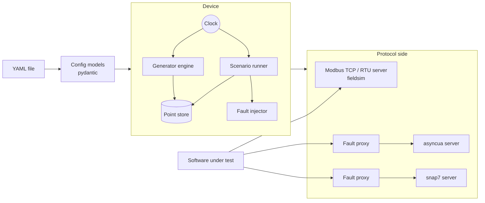

# Architecture

fieldsim separates *what a device knows* from *how it talks*.

## Shared by every protocol

- **Config models** (`fieldsim.config`) validate the whole file up front and
  report errors with their location.
- **Point store** — each protocol keeps its native representation (Modbus
  registers and bits, the OPC UA node values, S7 byte areas) and exposes
  points by name through the same small interface.
- **Generator engine** samples generators on the device clock and writes into
  the store. Points set from a test are pinned until released.
- **Scenario runner** turns scenario steps into a timeline of events and plays
  them on the device clock.
- **Fault injector** decides, per request, how to misbehave (`FaultPlan`). It
  knows nothing about bytes — the protocol side carries the plan out.
- **Clock** — real or virtual. The virtual clock wakes sleepers in deadline
  order and lets each schedule its next sleep before time moves on, which is
  what makes scenarios deterministic.
- **Write log** records every client write with the points it touched.

## Protocol side

**Modbus** has its own small asyncio server. The MBAP (TCP) and RTU framers are
pluggable and each knows how to damage its own frames, so fault injection
works at byte level.

**OPC UA** and **S7** reuse mature servers (asyncua, python-snap7). Faults are
applied by a proxy in front of them that understands just enough of the wire
protocol:

- it frames the stream (UA-TCP message chunks, TPKT packets),
- matches each response to its request (OPC UA request id, S7 PDU reference)
  and so applies the fault decided for a `Read` to that `Read`'s answer,
- for OPC UA, renumbers sequence numbers in both directions, because peers
  reject any gap — that is what keeps a session alive when a response is
  dropped or a ServiceFault is injected.

Outages stop the public listener only; the server behind it keeps its state.

## Running devices for tests

`BackgroundSimulator` runs a `Simulator` on its own event loop in a daemon
thread and hands out thread-safe `DeviceHandle`s, which is what the pytest
fixtures return. Tests therefore work the same whether the code under test is
synchronous, asyncio, trio or another process.
